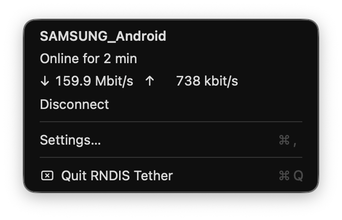
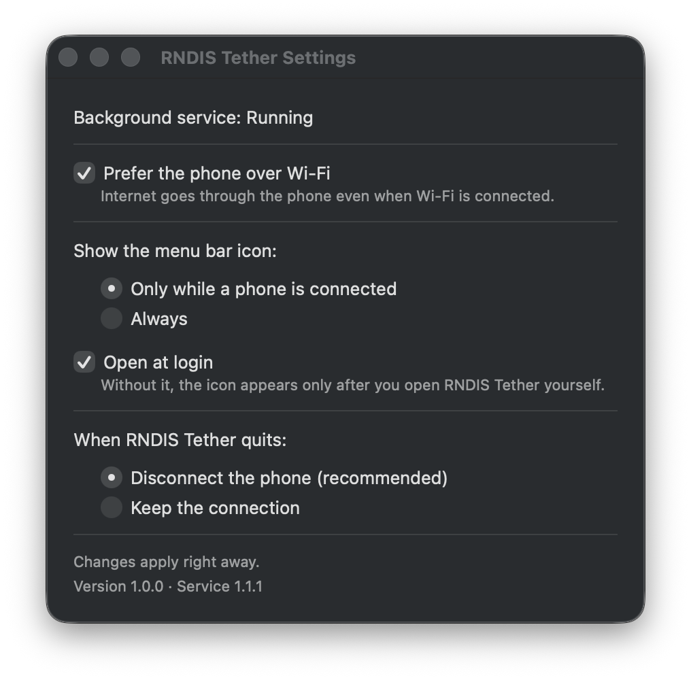

# RNDIS Tether

**Use your Android phone's internet on a Mac through a USB cable.**



Most Android phones share their internet over USB with RNDIS, a protocol that macOS does
not support. [rndis-tether](https://github.com/stlk0/rndis-tether) adds it as a background
service, and **RNDIS Tether** is its menu bar app: it installs the service for you and shows
whether the phone is connected and how fast the internet through it is.

## What you need

- A Mac with **macOS 13 Ventura or newer** (Apple silicon or Intel).
- An **Android phone** with USB tethering. Almost every Android phone has it.
- A **USB cable that carries data**. Some cheap cables only charge.

An iPhone does not need this: macOS supports iPhone tethering already.

## Install

Pick one of the two ways.

### Option A: one command

1. Open **Terminal**: press Cmd-Space, type `Terminal`, press Return.
2. Copy this line, paste it into Terminal and press Return:

   ```bash
   /bin/sh -c "$(curl -fsSL https://raw.githubusercontent.com/stlk0/rndis-tether-app/main/install.sh)"
   ```

   It puts RNDIS Tether in your Applications folder and opens it.
3. In the RNDIS Tether window, click **Install…** and type your Mac password (the one you
   log in with). This installs the background service that connects the phone. If your
   account is not an administrator, type an administrator's name and password.
4. The window then offers a few settings. The defaults suit most people, so just click
   **Done**.

macOS may show a notification about background items: that is RNDIS Tether and its
service, leave them allowed. From now on the app starts by itself when you log in.

### Option B: Homebrew

If you use [Homebrew](https://brew.sh):

```bash
brew install stlk0/tap/rndis-tether stlk0/tap/rndis-tether-app
```

Homebrew builds the app on your Mac, which takes a few minutes. To see it in the
Applications folder too:

```bash
ln -sf "$(brew --prefix)/opt/rndis-tether-app/RNDIS Tether.app" /Applications/
```

Then open RNDIS Tether from Applications and continue with steps 3 and 4 of Option A.

## Use

1. Connect the phone to the Mac with the cable.
2. On the phone, turn on **USB tethering**:
   - Samsung: *Settings > Connections > Mobile Hotspot and Tethering > USB tethering*
   - Pixel and most others: *Settings > Network & internet > Hotspot & tethering > USB tethering*
3. Wait a few seconds: the icon appears in the menu bar and turns solid when the Mac is
   online.

Next time, just plug in and turn on USB tethering again. Many phones switch it off by
themselves when the cable is unplugged; the Mac cannot change that.

Click the icon to see the phone, how long it has been online and the current download and
upload speed. The icon itself shows the state:

| Icon | Meaning |
| :-: | --- |
| <picture><source media="(prefers-color-scheme: dark)" srcset="docs/images/icon-online-dark.png"></picture> | Connected: the Mac uses the phone's internet |
| <picture><source media="(prefers-color-scheme: dark)" srcset="docs/images/icon-dimmed-dark.png"></picture> | Connecting, a problem (the menu says what to do), or you chose **Disconnect** |
| <picture><source media="(prefers-color-scheme: dark)" srcset="docs/images/icon-offline-dark.png"></picture> | No phone is plugged in, or the service is not running (on macOS 13 and 14 the icon is dimmed instead) |

By default the icon shows only while a phone is plugged in.

## Disconnect without unplugging

To stop using the phone's internet while the cable stays plugged in (for example to
charge the phone), choose **Disconnect** in the menu. The Mac goes back to Wi-Fi or
another connection. **Connect** in the same menu uses the phone again.

## Settings

Choose **Settings…** in the menu. While the icon is hidden, open RNDIS Tether from
Applications instead; if the app was not running, the first open only starts it, so open
it once more to see the window.



- **Prefer the phone over Wi-Fi** (on by default): all internet traffic goes through the
  phone while it is connected, even if Wi-Fi is on. Your local network (printers, file
  sharing) keeps working. Turn it off to keep Wi-Fi as the main connection and use the
  phone only when there is no other.
- **Show the menu bar icon**: only while a phone is connected, or always.
- **Open at login**: start the app when you log in. Without it, the icon appears only
  after you open RNDIS Tether yourself.
- **When RNDIS Tether quits**: disconnect the phone, or keep the connection so that the
  phone keeps working without the app.

Changes apply right away.

## Update

- Option A: run the same install command again. A running app switches to the new
  version by itself within a minute.
- Homebrew: `brew upgrade rndis-tether-app rndis-tether`. The app restarts into the new
  version by itself.

If the service needs an update too, the menu shows **Update Service…**. Click it, then
**Update…** in the window, and type your password. The internet through the phone stops
for a few seconds. Your settings are kept.

## Problems

| What you see | What to do |
| --- | --- |
| No icon in the menu bar | That is normal while no phone is plugged in. On macOS 26, check *System Settings > Menu Bar > Allow in the Menu Bar*. On a Mac with a camera notch, the icon may be hidden behind it: quit other menu bar apps to make room. |
| *Service not installed* or *not running* | Click **Install Service…** (or **Reinstall Service…**) in the menu, then **Install…** in the window. |
| The phone does not connect | Unlock the phone, check that USB tethering is on, and try another cable (it must carry data) or another USB port. Quit HoRNDIS or any other tethering tool. More in [rndis-tether's problem list](https://github.com/stlk0/rndis-tether#problems). |
| Connected, but websites do not open | Check that the phone itself has internet (mobile data on, not out of data). |
| **Open at login** is on, but the app does not start | Turn RNDIS Tether on in *System Settings > General > Login Items (& Extensions)*, under **Allow in the Background**. |

If you are stuck, [open an issue](https://github.com/stlk0/rndis-tether-app/issues/new?template=bug_report.md).

## Uninstall

1. In the settings, turn off **Open at login**, then choose **Quit RNDIS Tether** in the
   menu.
2. Remove the service. In Terminal:

   ```bash
   sudo rndis-tether uninstall
   ```

   Type your Mac password when asked. Nothing appears while you type; that is normal.
3. Move RNDIS Tether from Applications to the Trash. If you installed with Homebrew, run
   `brew uninstall rndis-tether-app rndis-tether` and delete the RNDIS Tether link from
   Applications.

The app's own settings stay on the Mac; to remove them too:
`defaults delete io.github.stlk0.rndis-tether-app`

## Privacy and safety

- The app sends nothing anywhere: no telemetry, no update checks. It only talks to the
  rndis-tether service on your Mac.
- Installing or updating the service asks for your password because the service runs as
  root: creating a network connection requires that. The code of both is open.
- The app is not signed with an Apple Developer ID. Both install options above avoid the
  macOS warning about that: the install command downloads the app that GitHub built from
  this code and checks its checksum, and Homebrew builds it on your Mac. If you download
  the archive from the Releases page in a browser instead, macOS blocks it until you allow
  it in *System Settings > Privacy & Security*.
- Internet through the phone uses its mobile data.

---

## Building from source

Needs the Xcode Command Line Tools 15 or newer (`xcode-select --install`).

```bash
make app     # build/RNDIS Tether.app
make test    # offline tests
make format  # format the code (swift-format, in the Command Line Tools 16 and newer)
make lint    # check the format, as CI does
make dist DAEMON_SRC=../rndis-tether  # the archive install.sh downloads, with rndis-tether inside
```

Options go after any of these, for example `make app VERSION=1.2.3`:

| Option | Default | What it does |
| --- | --- | --- |
| `ARCHS` | `arm64 x86_64` | Architectures to build; `ARCHS=x86_64` builds for Intel only |
| `VERSION` | `0.0.0` | The app version |
| `DAEMON_SRC` | none | A checkout of rndis-tether to build into the app (`Contents/Helpers`); `make dist` needs it |
| `CLI_PATH` | none | An rndis-tether command the app uses before its own; the Homebrew formula sets it |
| `SIGN_ID` | `-` (ad hoc) | A Developer ID identity to sign with; it also turns on the hardened runtime that notarization needs |
| `SWIFTFLAGS` | none | Extra compiler flags; CI adds `-warnings-as-errors` |

A build and an installed RNDIS Tether share their settings and login item, and only one of
them runs at a time: opening a build quits the installed copy. To go back, quit the build
and open the installed app.

## License

[MIT](LICENSE)
